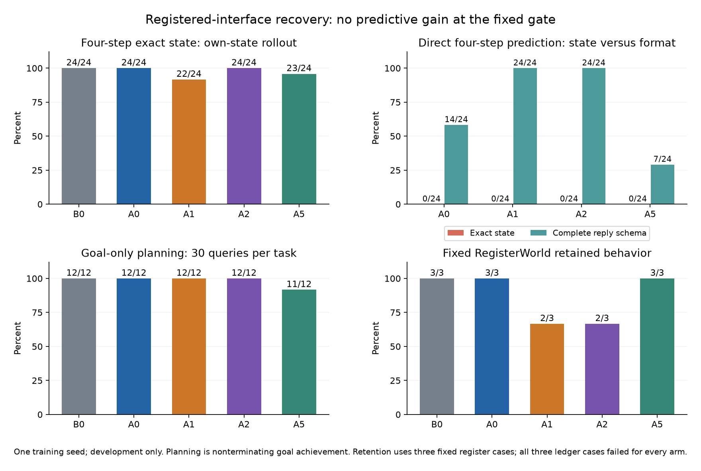

# Registered-interface recovery: interim evidence

Updated 2026-10-12 UTC after the predictive pilot, TRAIN-only H3 teacher, warm
references, all four H3 continuation training runs and partial singleton parity.
Full research goal remains
open; H3 student readouts,
Ledger and Blocksworld native work remain. The first H3 attempt stopped before
model loading; its same-input retry completed. See `NATIVE_QUEUE.md`.
Checkpoint14 passed290 tests and compilation, with test evidence in
`results/recovery-v1/TESTS_CHECKPOINT_14.txt`. Checkpoint11 verifies the teacher,
student-training and warm guard/proposer freezes; checkpoint12 verifies the
separate Ledger/RP and Block CPU11 phase freezes. Prospective Ledger,
R/P-retention and constructed Blocksworld G1 inputs are frozen; their native
outcomes are still unknown.
The consolidated report is `WARM_RESEARCH_REPORT_2026_10_12.md`; it adds actual
parent exposure, cost/regret denominators, uncertainty and current integration
decisions without changing the original endpoints or failed gates.
The H3 retry used a separate prospective CPU11 admission profile after RCX's
release; prediction/data/gates and historical loaders remain unchanged.
Warm guards/proposers completed after the RDW E06 slot002 release. Peer slot004
has now exited1 after a bounded wait and its helper released; no own model is
active at the latest checkpoint. The no-model CPU11 check10.917744GiB physical
failed admission. The reviewed and prospectively frozen singleton A0 readout
completed with exact full raw-trace parity; A2 refused before core load at
10.067127GiB physical, below its10.5GiB floor. A2 parity and all actual student
outcomes remain pending. See [singleton evidence](H3_SINGLETON_CHECKPOINT_2026_10_12.md),
resource clarifications3–6 and the current execution queue. Historical loaders,
results and admission floors remain unchanged.

## Qualified TRAIN-only H3 teacher

The unchanged32-parent TRAIN task pool produced27 independently verified
retained plans,20 distinct action sequences and all three limits24/32/40. The
fixed corpus gate passed; five failed parents and all negatives remain preserved.
Learned searches/rankings were fixed before independent exact verification.
All retained plans use the registered final-finish contract. This qualifies
the training corpus, without establishing student, DEV or confirmation benefit.

The successful retry took841.880s and960 learned transition queries. CPU11
admission observed11.766GiB physical and19.535GiB commit availability after
imports; sampled process-tree peak was5,147,717,632 bytes (4.794GiB).
Verified corpus SHA256:
`3a2a25a33b7dc983b422b67fc1a1977d7315896e42c72132a454012c27f1841b`.
See [the qualification report](H3_TEACHER_QUALIFICATION_2026_10_12.md) for the
full failure, cost and provenance audit.

Actual A0/A2 warm artifacts and this shared corpus are now bound by
`RECOVERY_H3_STUDENT_TRAIN_FREEZE_V3_CPU11.json`; fixed warm dynamics/behavior
guards are bound by `RECOVERY_H3_WARM_GUARDS_FREEZE_V3_CPU11.json`, and warm
proposer references by `RECOVERY_H3_WARM_READOUT_FREEZE_V3_CPU11.json`. Those warm
readouts completed: both have24/24 rollouts, but0/48 valid complete plans and
0/12 top1/pass@4/hybrid success. See [warm references](H3_WARM_REFERENCES_2026_10_12.md).

A3/A4/C3/C4 then completed32 updates each. Nominal forwards are128/64/128/64;
input/supervised tokens are21,884/1,938;8,420/1,000;21,968/1,870;8,504/932.
A3 used CPU11; A4's initial zero-update preload refusal is preserved, and its
bounded retry plus C3/C4 used the separately frozen CPU10.5 training-only path.
Actual output readout/guard V3 CPU11 freezes now exist. See
[the training checkpoint](H3_TRAINING_CHECKPOINT_2026_10_12.md) for costs and hashes.
There are no student DEV readout outcomes yet. The failed RegisterWorld predictive
gain gate, sealed confirmation bank and integration restrictions remain intact.

## Completed adapted dynamics pilot

| Arm | Updates | Train positions | Supervised / auxiliary tokens | Training seconds | Rollout h4 | Direct h4 | Direct h4 malformed |
|---|---:|---:|---:|---:|---:|---:|---:|
| A0 | 32 | 4,252 | 466 / 0 | 63.745 | 24/24 | 0/24 | 10/24 |
| A1 | 32 | 4,252 | 466 / 434 | 71.395 | 22/24 | 0/24 | 0/24 |
| A2 | 32 | 17,716 | 1,404 / 0 | 238.580 | 24/24 | 0/24 | 0/24 |
| A5 | 96 | 12,768 | 1,410 / 0 | 185.035 | 23/24 | 0/24 | 17/24 |

All four scored 24/24 at rollout h1/h2. Direct h2 was 2/24,3/24,3/24,1/24,
respectively. A1 loses two unseen-limit rollout cases; A5 loses one. A0/A2
preserve the inherited B0 state ceiling. Neither A1 nor A2 meets the fixed
>=2/24 paired rollout-gain continuation gate. No efficacy, equivalence or
larger RegisterWorld training qualification follows from these outcomes.

A1/A2 improve direct-reply grammar without learning accepted four-step states.
This separates format learning from dynamics learning. Final-state evaluation
and posthoc trace audits remain unchanged; speculative explanations require
further independently registered interventions, not repair of these outputs.

Every inference arm activates 606,142,464 parent+LoRA parameters. Training has
10,092,544 LoRA parameters; A1 adds 51,200 auxiliary parameters omitted at
inference. A2 uses96 nominal forwards, as does A5, but processes38.8% more
positions and takes28.9% more measured training time. The conventional parameter-
token estimate is a rough proxy, not measured FLOPs. Training peak working sets
were about3.77–3.79GB; dynamics process-tree sampled peaks about4.83–4.84GB.
GPU memory is unmeasured. Resource counts include the declared single-seed scope.

## Planning and behavioral retention

| Arm | Goal-only planning | Optimal move counts | First action optimal | Six-fixture behavior |
|---|---:|---:|---:|---:|
| B0 | 12/12 | 7/12 | 8/12 | 3/6 |
| A0 | 12/12 | 7/12 | 8/12 | 3/6 |
| A1 | 12/12 | 7/12 | 8/12 | 2/6 |
| A2 | 12/12 | 7/12 | 8/12 | 2/6 |
| A5 | 11/12 | 6/12 | 8/12 | 3/6 |

All used360 learned transition queries,42,681 prompt tokens and the common
depth6/query30 per-parent caps. Actual planning time was about250–254s, with
sampled process-tree peaks about5.21GB. Caps do not imply equal realized cost.
The selected successful paths have no wrong intermediate states. Every success
is nonterminating goal achievement under the registered P2 predicate; H3's
final-finish contract is stricter and must remain separately reported.

Posthoc unused-branch audits find own-input state/legality errors even with
perfect selected-plan success. Correct queries out of360: B0 358,A0 356,A1 349,
A2 358,A5 349; A1 has4 malformed/unknown cases. These are dependent repeated
queries (245 unique conditionings in B0/A0/A1/A2,240 in A5;12 parents),
not360 independent trials.
All72 finish queries per arm predict termination correctly. Calibration remains
unknown. Original P2 and selection are unchanged.

The six behavior fixtures comprise three RegisterWorld and three Ledger cases.
B0/A0/A5 preserve3/3 Register cases and score0/3 Ledger cases; there is no
inherited Ledger success here to certify retention. A1/A2 lose the known boundary
legality case: add1 at x32/limit32 returns unchanged x32 but incorrectly legal=true.
Thus state-only P1 can mask a retained-legality regression. No broad retention
pass follows from these six cases.

A0 and A5's first32 loss values and step32 adapter weight SHA are identical:
`9b6ff87157ba7418fd328e1325c1461a7bbf305e01d13381d6225c4f8332cfe9`.
This is concrete native training-prefix parity, not multi-seed replication.

Sources: `results/recovery-v1/TRAINING_SUMMARY_01.json`, four `*_dynamics.json`
and posthoc/resource supplements; prospective
`prereg/RECOVERY_ALL_ARMS_READOUT_FREEZE_V3.json`. Original B0 evidence follows.

## Inherited baseline evidence

The native 596,049,920-parameter Titan-Sparse parent loaded in FP32, TF32 off,
with the unmerged registered `F_titan_main` adapter. Adapter SHA-256:
`c465356f85ead24b609af2b8b1cb0a14799e6d2d16116944c9c607c933e66466`.
Rank 16, alpha 32, dropout .05, q/k/v/o/gate/up/down. Every original one-step
prompt is byte-identical to `rw2`. No core or owner artifact was modified.

Fresh recovery manifest SHA-256:
`20c593a683fed07e21c226fa77189b1b4be7cea92c186ff27881c4c21d65b9fe`.
TRAIN offers128 independent parents; the32-step arms actually draw29 distinct
parents and A5 draws64 in96 updates. TRAIN limits are24/32/40. DEV has12
teacher-known ID parents using inherited-F one-step keys
and 12 unseen-limit parents at limits 80/96, including six starts outside inherited
numerical support. The ID cohort tests new compositions of seen transitions.
This is not proof of unseen parent-backbone arithmetic.

| B0 metric | ID | Unseen limits | All |
|---|---:|---:|---:|
| Free-running exact state h1 | 12/12 | 12/12 | 24/24 |
| Free-running exact state h2 | 12/12 | 12/12 | 24/24 |
| Free-running exact state h4 | 12/12 | 12/12 | 24/24 |
| Direct h1 exact state | 12/12 | 12/12 | 24/24 |
| Rollout legality h1/h2/h4 | 12/12 each | 12/12 each | 24/24 each |
| Malformed replies | 0 | 0 | 0 |

Qualification took 88.196 seconds including loading/hashes, with 120 learned
queries, 14,246 prompt tokens and 1,789 output tokens. The conservative processed
position upper bound is 15,960. These are native CPU measurements. Direct h2/h4
was not measured in B0's qualification schedule. Its later planning and
behavioral retention results are reported above.

Source: `results/recovery-v1/B0_qualification.json`, prospectively frozen by
`prereg/RECOVERY_FREEZE_V1.json`. The posthoc supplement reconstructs all 120
raw replies without transition execution and verifies original P1 unchanged.
State, legality, termination and cumulative attempted-failure are correct for
every parent at every step. No correct-final/wrong-intermediate cases occurred.
Calibration is unknown because probabilities were not captured.

This fixes the initial screen's interface/undertraining qualification failure.
It does not establish H1/H2/H3. The fixed 24-parent P1 cohort is at ceiling for
B0. A1/A2 beating a degraded A0 would show adaptation preservation, not accuracy
improvement beyond inherited F. No parents will be redrawn to manufacture a gain.

Warm A0/A1/A2 32-step and A5 96-step recipes used
`RECOVERY_TRAIN_FREEZE_V2.json`. RDW E05 completed/released before these jobs.
Planning and fixed behavioral retention completed. G4/G5 remain
unqualified for this RegisterWorld predictive recipe.

V1's editorial `term` spelling was clarified to actual `terminated` before B0
results were read and before recovery training. Explicit AdamW defaults/no
scheduler are bound for all arms: this is a new controlled recipe, not exact
historical retraining. Original V1 trainer bytes are preserved by hash under
`prereg/source_snapshots/`.

Original cold rank-4 pilot records remain unchanged: four arms returned state
0/2 and planning 0/1, so that screen could not discriminate efficacy. Recovery
changes interface, capacity and initialization together and does not isolate
the cause of the prior failure. H4/H5 remain conditional; no integration or
confirmation claim follows from recovery.
